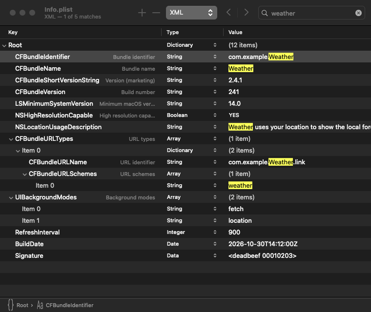
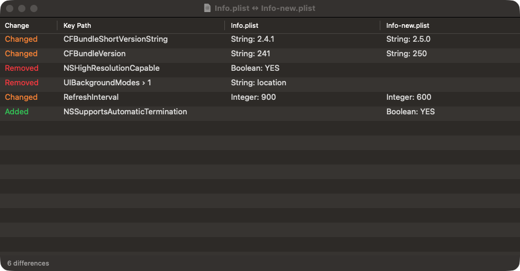

<p align="center"></p>

# Pliable

A small, fast, native macOS editor for property lists.

Double-clicking a `.plist` normally launches Xcode, which takes several seconds before the window shows up.
Pliable opens the same file in well under a second and edits it the way Xcode does.



## What it does

- **Opens instantly.** Native AppKit, no dependencies, universal binary (Apple silicon and Intel).
- **Every plist format.** Reads and writes **XML**, **binary** and **OpenStep** (old-style ASCII) property lists, plus `.strings` files.
  Switch the save format from the toolbar.
- **Keeps your key order** in XML and OpenStep files, like Xcode, so diffs in git stay small.
- **Edits like Xcode.** Key / Type / Value tree with every plist type, including `NSKeyedArchiver` UIDs.
  Add, delete, rename, retype, drag to reorder, copy and paste, with full undo.
- **Knows what keys mean.** Well-known Info.plist, entitlements and launchd keys show a readable name next to the
  raw key (`CFBundleVersion` · Build number) — both at once, unlike Xcode’s either/or — and a warning when a value
  has the wrong type (⚠︎ should be String). Typing a key suggests known keys for that file; values with a fixed set
  of choices (app category, package type, interface orientations, …) suggest those. A new item renamed to a known
  key gets the right type. **View → Show Key Names** (⌥⌘K) hides the names.
- **Editors that fit the value.** Multi-line strings, dates and data open in a popover (double-click, ↩ or ⌥⌘↩):
  a text editor with line and character counts, a calendar and clock with a Now button, and a hex editor with an
  ASCII column. Long or multi-line strings show line breaks as ⏎ in the list.
- **Always know where you are.** A path bar under the tree shows the selected item’s location (`Root › Settings ›
  Color`); click a part to jump there. **Copy Key Path** (⌥⌘C) copies `Settings.Color`, **Copy PlistBuddy Path**
  copies `:Settings:Color`. Type a key’s first letters to select it.
- **Tidy up quickly.** **Sort Keys** (alphabetical, numbers in natural order) for one dictionary or recursively,
  **Duplicate** (⌘D), and a right-click menu with every item command.
- **See what you haven’t saved.** The title bar says “Unsaved changes” until you save, and each item you changed
  since the last save has a blue bar at the row’s edge. Undoing back to the saved state clears both.
- **Search with ⌘F.** Finds keys and values anywhere in the tree, expands collapsed items to show each match,
  highlights matching text and shows “2 of 5 matches” in the title bar. Step through matches with the ‹ › buttons.
- **Compare and edit two plists side by side.** **File → Compare With…** (⇧⌘D) shows both files in one tree, rows
  lined up by key, each file with its own Key, Type and Value columns, so a key that only one file has appears only
  on that file’s side. Keys only in the other file are green, keys only in yours red, changed values orange, with a
  colored bar at the row’s edge that stays visible when the row is selected. Edit keys, types and values on either
  side, delete a row from one side, or copy a row across with the ← → toolbar buttons, the right-click menu or
  ⌃⌘← / ⌃⌘→. Each file keeps its own undo; ⌘S saves whichever side has changes. Step through differences with
  the ˄ ˅ buttons (or ⌘G / ⇧⌘G), or tick **Only Differences** to hide the rest. The view updates live as you edit
  or as either file changes on disk, and clicking a row jumps to it in the editor.
- **Quick Look preview.** Press Space on a plist in Finder to see it as a collapsible Key / Type / Value tree
  (any format Pliable reads). macOS picks up the extension after Pliable has been launched once.
- **Drag a plist onto an open window** to open it in a new tab or compare it with the one you have open.
- **Picks up changes on disk.** When another app or a script rewrites the file, Pliable reloads it and keeps your
  expanded rows and selection. If you have unsaved edits, it asks first.



## Install

```sh
brew tap doronz88/tap
brew trust --cask doronz88/tap/pliable   # recent Homebrew requires trusting third-party casks
brew install --cask doronz88/tap/pliable
```

Or download `Pliable-<version>.zip` from [Releases](https://github.com/doronz88/Pliable/releases) and move `Pliable.app` to `/Applications`.

> [!NOTE]
> Pliable is ad-hoc signed, not notarized. On first launch macOS will refuse to open it; allow it in
> **System Settings → Privacy & Security → Open Anyway**, or run
> `xattr -dr com.apple.quarantine /Applications/Pliable.app`.

To open plists with Pliable by default, choose **Pliable → Make Pliable the Default Plist Editor**
(macOS asks you to confirm), or in Finder select any `.plist` → **Get Info** → **Open with: Pliable** → **Change All…**

## Usage

| Action | Shortcut |
|---|---|
| Add item | `+` or `⌘↩` |
| Edit value of selected row | `↩` |
| Delete selected items | `⌫` or `⌘⌫` |
| Undo / Redo | `⌘Z` / `⇧⌘Z` |
| Edit value in a popover (text, date, data) | `⌥⌘↩`, or double-click / `↩` on dates, data and long text |
| Duplicate selected items | `⌘D` |
| Copy key path | `⌥⌘C` |
| Select a key by name | type its first letters |
| Show / hide readable key names | `⌥⌘K` |
| Show suggestions while editing a key or value | type, or `Esc` |
| Expand / collapse all | `⌥⌘→` / `⌥⌘←` |
| Find | `⌘F` |
| Next / previous match | `↩` / `⇧↩` in the search field, `⌘G` / `⇧⌘G`, or the ‹ › buttons |
| Compare with another plist | `⇧⌘D` |
| Next / previous difference (compare window) | `⌘G` / `⇧⌘G` or the ˄ ˅ buttons |
| Copy selected rows to the left / right side (compare window) | `⌃⌘←` / `⌃⌘→` |
| Make the left / right side match the other (compare window) | `⇧⌃⌘←` / `⇧⌃⌘→` |

New items go into the selected container when it is expanded (or Root), otherwise right after the selected row.

## How formats are handled

| Format | Read | Write | Key order |
|---|---|---|---|
| XML | Foundation `XMLParser` | Pliable (Apple-style output) | Preserved |
| Binary | `PropertyListSerialization` | `PropertyListSerialization` | Not preserved (same as Xcode) |
| OpenStep / `.strings` | Pliable | Pliable | Preserved |

Notes:

- XML files that `XMLParser` rejects but Foundation accepts (for example unquoted attributes in the XML declaration)
  still open through `PropertyListSerialization`; the window subtitle then says key order could not be read.
- XML cannot store strings containing NUL characters and keeps dates to whole seconds (same as Foundation).
- OpenStep can only hold strings, data, arrays and dictionaries; Pliable refuses to save other types in that format.

## Build from source

Requires Xcode (or the Swift toolchain) on macOS 14 or later.

```sh
./build.sh                         # build/Pliable.app
UNIVERSAL=1 VERSION=1.0.0 ./build.sh
swift test                         # unit tests
./install.sh                       # build and install into /Applications (DEST=… for elsewhere)
```

`install.sh` stamps the latest release tag as the version, quits a running Pliable first, moves a copy it didn’t
install itself (such as a Homebrew one) to the Trash, and registers the app so Finder and Quick Look pick it up.

`pliable-verify` round-trips a list of plists through Pliable and compares the result with Foundation:

```sh
swift build -c release --product pliable-verify
find /System/Library -name '*.plist' | .build/release/pliable-verify
```

## Releasing

Push a tag `vX.Y.Z`. The release workflow tests, builds a universal app, attaches `Pliable-X.Y.Z.zip` to a GitHub release
and, if the `TAP_DEPLOY_KEY` secret is set (a write deploy key on the tap), bumps the cask in [doronz88/homebrew-tap](https://github.com/doronz88/homebrew-tap).

## License

MIT
